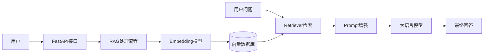
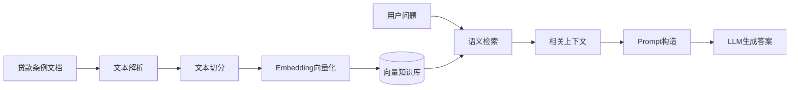

# 贷款条例智能问答系统（Loan RAG Assistant）

## 当前可运行版本（2026-10-03）

当前是带网页界面的条例检索演示。使用构造的示例文档与 8 个章节，按问题中的主题关键词检索，保留原文、章节、版本及引用编号。不同问题会检索不同段落；缺少主题依据或具体数值时明确提示。页面支持从回答的引用定位到知识库原文。

**本版本未调用大模型、Embedding、Milvus / FAISS 或 RAGAS。** 使用主题关键词与字符二元组排序，回答由原文摘录组成。示例文档不是银行政策、真实合同或金融建议。后文的向量检索与 LLM 架构保留为原设计目标，不能视为当前已实现能力。

在 Python 3.12 环境、仓库根目录执行：

```bash
python -m pip install -r requirements-deploy.txt
python -m backend.serve
```

访问 `http://127.0.0.1:8000/`；健康检查 `/healthz`；接口文档 `/docs`；JSON 接口 `POST /api/chat`。旧 `POST /chat?question=...` 保留 answer 字符串、context 列表，并扩展引用与状态字段。公网地址尚未创建。

详细启动与部署见 [DEPLOYMENT.md](DEPLOYMENT.md)。原 `knowledge_base/loan_rules.txt` 保留不变，新演示文档位于 `knowledge_base/demo_rules.json`。

---

## 以下为原有背景与设计目标

## 项目背景

金融贷款业务中存在大量政策文件、产品说明、业务规范以及合同条例。用户和业务人员在查询相关信息时，需要从大量文档中人工查找，效率较低，同时容易因为信息遗漏导致理解偏差。

本项目面向金融贷款知识查询场景，基于 RAG（Retrieval Augmented Generation，检索增强生成）技术构建智能问答系统。

系统通过文档解析、文本切分、向量检索以及大语言模型生成，实现基于真实知识库内容的准确问答。


# 项目介绍

本项目构建了一个贷款条例智能问答助手，主要完成：

- 贷款文档解析
- 知识库构建
- 文本向量化
- 相似度检索
- Prompt增强
- 大模型回答生成

用户可以通过自然语言询问贷款相关问题，系统从知识库中检索相关条例，并结合大模型生成回答。


# 系统架构




# RAG核心流程




# 项目亮点


## 1. 基于RAG的知识增强

解决大语言模型无法直接获取业务知识的问题。

通过：

```
业务文档

↓

文本切分

↓

Embedding

↓

向量数据库

↓

相似度检索

↓

LLM回答
```


## 2. 文档检索优化

针对贷款条例文档特点：

- 长文本
- 专业术语多
- 条款关联复杂

采用：

- 文本分块
- 语义检索
- Top-K召回


## 3. RAG效果评估

引入 RAGAS 思路，对系统效果进行评价：

- Context Relevance
- Faithfulness
- Answer Relevance


# 项目结构

```
loan-rag-assistant

├── backend
│   └── main.py

├── rag
│   ├── loader.py
│   ├── splitter.py
│   ├── embedding.py
│   ├── retriever.py
│   └── generator.py

├── knowledge_base
│   └── loan_rules.txt

├── evaluation
│   └── ragas_eval.py

└── requirements.txt
```


# 技术栈

| 技术 | 应用 |
| --- | --- |
| Python | 后端开发 |
| FastAPI | 服务接口 |
| LangChain | RAG流程构建 |
| Embedding | 文本向量化 |
| FAISS/Milvus | 向量检索 |
| LLM | 智能问答 |
| RAGAS | 效果评估 |


# 面试重点


## 为什么需要RAG？

大模型本身没有企业内部知识。

通过RAG将业务文档检索后作为上下文输入模型，提高回答准确性。


## 文档为什么需要切分？

过长文本直接输入模型会：

- 超过上下文限制
- 降低检索准确性

通过合理切分提高召回效果。


## 如何降低幻觉？

主要方法：

- 提供真实知识上下文
- 限制模型基于检索内容回答
- 通过评估指标优化检索策略


# 项目总结

本项目围绕金融贷款知识问答场景，实践了企业级AI应用中的核心技术：

- 文档知识库构建
- RAG检索增强
- Prompt设计
- 大模型问答
- RAG效果评估

实现了从非结构化业务文档到智能问答应用的完整流程。
